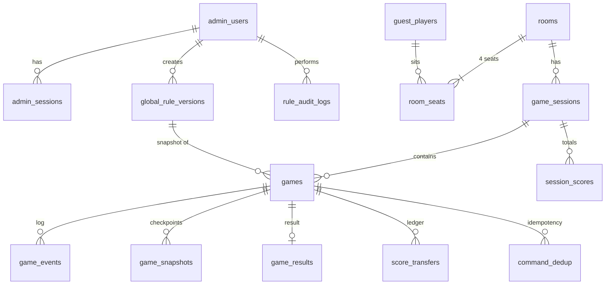

# GĐ2.1 — Kiến trúc, ADR và ERD

## 1. Tổng quan kiến trúc (chạy một process)

```
 Browser (React + TS + Vite)                       Admin browser
   │  HTTPS REST  /api/*                              │ HTTPS REST /api/admin/*
   │  WSS        /ws/rooms/{roomId}                   │ (cookie session + CSRF)
   ▼                                                  ▼
┌──────────────────────── Caddy (TLS, static frontend, reverse proxy) ───────────────────────┐
└────────────────────────────────────────────┬───────────────────────────────────────────────┘
                                             ▼
┌──────────────────────────── FastAPI app (uvicorn, 1 worker) ───────────────────────────────┐
│  api/        REST routers (admin, rules, guests, rooms, history)                           │
│  realtime/   WS gateway · RoomActor (asyncio.Lock + state cache) · TimerService            │
│  services/   RuleService · RoomService · GameService · ScoringService · RecoveryService     │
│  repo/       SQLAlchemy 2.x async repositories (asyncpg)                                   │
│  ───────────────────────────── import một chiều ─────────────────────────────              │
│  tlmn_engine/  (package Python THUẦN: không FastAPI, không DB, không clock, không random)  │
│     cards · combos · compare · chop · rules_config · state · reducer · scoring · projection│
└────────────────────────────────────────────┬───────────────────────────────────────────────┘
                                             ▼
                               PostgreSQL 16 (JSONB, Alembic)
```

Dòng xử lý một lệnh game (chi tiết ở [04](04-api-realtime-recovery.md)):
`WS frame → validate envelope → RoomActor.lock → engine.apply(state, action, rules, now) → 1 DB transaction (events + ledger + snapshot + idempotency) → commit → cập nhật cache → ack → broadcast theo quyền xem`.

## 2. Architecture Decision Records

| ADR | Quyết định | Lý do / hệ quả |
|---|---|---|
| 001 | Monorepo: `engine/` (package `tlmn_engine`), `backend/`, `frontend/`, `docs/`, `deploy/` | Engine tách framework/DB, test độc lập; backend import engine, không chiều ngược lại |
| 002 | **Server-authoritative**, client chỉ gửi intent (`play` với danh sách lá, `pass`, `ready`) | Client không tự tính hợp lệ/kết quả; UI chỉ gợi ý |
| 003 | **1 process, 1 uvicorn worker**; mỗi phòng có `RoomActor` giữ `asyncio.Lock` + state cache | Đơn giản, không cần distributed lock. Khi cần mở rộng nhiều server: sticky routing theo roomId + Redis pub/sub (Redis không thay DB) |
| 004 | PostgreSQL + SQLAlchemy 2.x **async** + asyncpg + Alembic; JSONB cho rules/snapshot/event payload | Theo yêu cầu; JSONB đủ cho dữ liệu bán cấu trúc |
| 005 | **Event log + snapshot**: `game_events` append-only, `game_snapshots` mỗi khi đóng vòng và mỗi 20 event | Khôi phục = snapshot gần nhất + replay events; đối soát tranh chấp |
| 006 | **Commit trước, ack/broadcast sau** | Không bao giờ broadcast trạng thái chưa bền vững |
| 007 | Engine **deterministic**: `apply(state, action, rules, now) -> (state', events)`; thời gian và bộ bài truyền vào | Replay ra đúng kết quả; property test được |
| 008 | Xáo bài bằng `secrets.SystemRandom`; lưu thứ tự 52 lá (server-only) + **deck commitment** `sha256(deck‖salt)` công bố lúc chia, lộ `salt` sau khi ván kết thúc | Chống nghi ngờ server gian lận; người chơi tự kiểm chứng được |
| 009 | RuleConfig = Pydantic v2 model, có `schemaVersion` + migration bằng hàm Python; **không nhận script/biểu thức** | Theo yêu cầu §6 |
| 010 | Rollback luật = **tạo version mới** sao chép config của version đích | Version tăng đơn điệu, audit tuyến tính, snapshot ván cũ không bị ảnh hưởng |
| 011 | Sổ điểm **double-entry**: mọi biến động điểm là một `transfer(from, to, amount>0, reason)` | Zero-sum theo cấu trúc, không cần kiểm tra sau |
| 012 | Admin auth: username + **argon2id**, session token ngẫu nhiên lưu hash, cookie `HttpOnly; Secure; SameSite=Strict` + CSRF header | Thu hồi được phiên; không JWT stateless |
| 013 | Guest auth: token ngẫu nhiên 256-bit, DB lưu `sha256`; gửi qua header `Authorization` (REST) và message `auth` đầu tiên (WS) — **không đặt trong URL** | Tránh lộ token qua log/proxy/history |
| 014 | Timer theo **deadline tuyệt đối** lưu trong state/event; sau khi restart server, lượt hiện tại được **cấp lại đủ thời gian** (grace) | Không phạt người chơi vì server sập (cần duyệt — G5) |
| 015 | Triển khai: Docker Compose (`caddy`, `api`, `db`), backup `pg_dump` hằng ngày + WAL archive tùy chọn | Chi tiết ở GĐ3 |

## 3. ERD



### 3.1 Bảng và khóa

| Bảng | Cột chính | Khóa / index / ràng buộc |
|---|---|---|
| `admin_users` | id uuid, username, password_hash, is_active, failed_attempts, locked_until, created_at, last_login_at | PK id; UNIQUE lower(username) |
| `admin_sessions` | id uuid, admin_id, token_hash char(64), csrf_hash, created_at, expires_at, revoked_at, ip, user_agent | UNIQUE token_hash; idx (admin_id) |
| `global_rule_versions` | id, version int, status `DRAFT/ACTIVE/SUPERSEDED/DISCARDED`, schema_version, config jsonb, config_hash char(64), based_on_version, lock_version int, note, created_by, created_at, published_by, published_at | UNIQUE version (NULL cho draft); **partial UNIQUE (status) WHERE status='ACTIVE'**; **partial UNIQUE (status) WHERE status='DRAFT'** (một draft chung) |
| `rule_audit_logs` | id bigserial, admin_id, action, rule_version_id, before_hash, after_hash, diff jsonb, ip, user_agent, created_at | Append-only (role app không có UPDATE/DELETE); idx (created_at), (rule_version_id) |
| `guest_players` | id uuid, nickname varchar(20), token_hash char(64), created_at, last_seen_at, expires_at | UNIQUE token_hash; idx (expires_at) |
| `rooms` | id uuid, code char(6), owner_guest_id, status `WAITING/PLAYING/CLOSED`, current_session_id, created_at, closed_at, close_reason | **partial UNIQUE (code) WHERE status<>'CLOSED'**; idx (status) |
| `room_seats` | room_id, seat_no 0–3, guest_id, conn_state `EMPTY/CONNECTED/DISCONNECTED`, ready bool, hold_until, joined_at | PK (room_id, seat_no); partial UNIQUE (guest_id) WHERE guest_id IS NOT NULL (một guest chỉ ngồi 1 phòng mở) |
| `game_sessions` | id uuid, room_id, session_no, roster jsonb `{seat: guestId}`, status `ACTIVE/ENDED`, end_reason, started_at, ended_at | UNIQUE (room_id, session_no); partial UNIQUE (room_id) WHERE status='ACTIVE' |
| `games` | id uuid, session_id, room_id, game_no, rule_version_id, **rules_snapshot jsonb**, rules_hash, opening_mode `THREE_CLUBS/WINNER_LEADS`, leader_seat, deck jsonb (server-only), deck_salt, deck_commitment, redeal_count, status `IN_PROGRESS/FINISHED/CANCELLED`, end_type `NORMAL/INSTANT_WIN/BLIND_THREE_SPADES/CANCELLED`, last_seq, state_hash, started_at, ended_at | UNIQUE (session_id, game_no); partial UNIQUE (room_id) WHERE status='IN_PROGRESS'; **trigger chặn UPDATE rules_snapshot/rules_hash/deck** |
| `game_events` | id bigserial, game_id, seq int, type, actor_seat, request_id uuid, payload jsonb, post_state_hash, created_at | UNIQUE (game_id, seq); append-only |
| `command_dedup` | game_id, seat, request_id, outcome jsonb (ack/error đã trả), created_at | PK (game_id, seat, request_id) |
| `game_snapshots` | game_id, seq, state jsonb, state_hash, created_at | PK (game_id, seq) |
| `game_results` | game_id, ranks jsonb `{seat: rank}`, statuses jsonb (`FINISHED/CONG/FORFEITED`), net jsonb `{seat: delta}`, end_type, created_at | PK game_id → **không thể ghi kết quả 2 lần** |
| `score_transfers` | id bigserial, game_id, session_id, origin_seq, line_no, from_guest, to_guest, from_seat, to_seat, amount int > 0, reason, detail jsonb, created_at | UNIQUE (game_id, origin_seq, line_no); CHECK amount > 0 AND from_guest <> to_guest; idx (session_id) |
| `session_scores` | session_id, guest_id, total int, games_counted int, updated_at | PK (session_id, guest_id); cập nhật trong **cùng transaction** với `game_results` |

### 3.2 Chống cộng điểm trùng
- `game_results.game_id` là PK; `session_scores` chỉ được cộng trong transaction có INSERT `game_results` thành công.
- `score_transfers` có khóa tự nhiên `(game_id, origin_seq, line_no)`, nên khi event được replay thì INSERT thứ hai bị từ chối.
- Tổng điểm phiên chỉ tính các ván `FINISHED`. Ván `CANCELLED` bị loại, kể cả các transfer chặt đã phát sinh trong ván (Q-P1-9).

### 3.3 Retention và quyền đọc

| Dữ liệu | Giữ | Ai đọc |
|---|---|---|
| `rule_audit_logs`, `global_rule_versions` | Vĩnh viễn | Admin |
| `games`, `game_events`, `game_results`, `score_transfers` | 365 ngày (cấu hình được) | 4 người trong ván (bài đối thủ chỉ hiện sau khi ván kết thúc); Admin xem toàn bộ để xử lý tranh chấp |
| `game_snapshots` | Xóa 30 ngày sau khi ván kết thúc (events đủ để tái tạo) | Chỉ server |
| `games.deck` | Như `games` | Server; client chỉ nhận sau khi ván kết thúc qua replay |
| `guest_players` | Hết hạn sau 30 ngày không hoạt động (sliding) | Bản thân guest |
| `admin_sessions` | 7 ngày sau khi hết hạn | Server |

DB role: `app_rw` (ứng dụng, không có quyền UPDATE/DELETE trên `rule_audit_logs`, `game_events`, `score_transfers`), `app_migrate` (Alembic), `backup_ro`.
